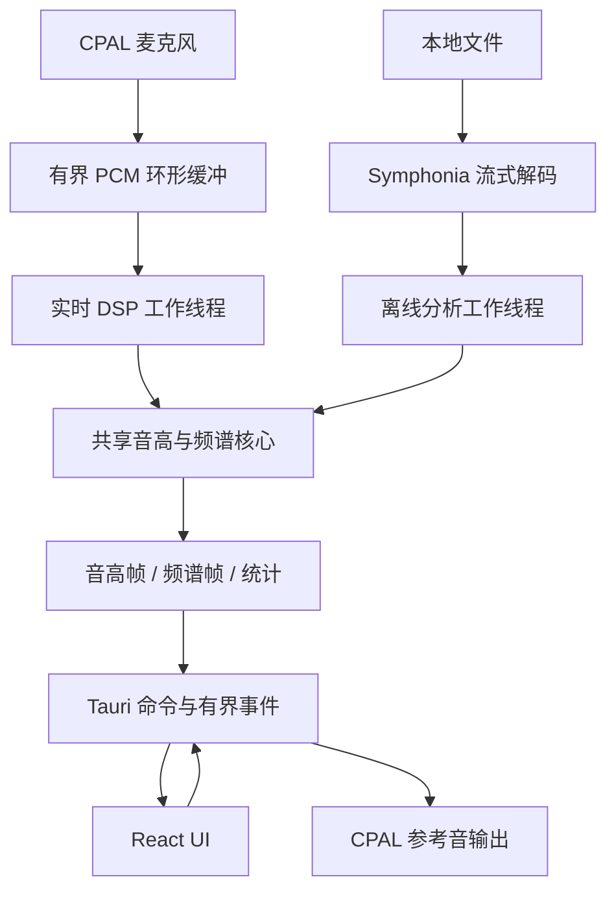

# Universal Tuner — 分阶段开发任务书

> 版本：v1.0 · 2026-11-24  
> 状态：需求已确认，待初始化仓库  
> 用途：项目主需求文档、技术方案、Codex 执行与交接规范  
> 建议位置：`docs/UNIVERSAL_TUNER_DEVELOPMENT_PLAN.md`

本文是计划，不代表项目已经创建或测试通过。首次执行时以实际仓库和本机环境为准。用户确认的需求优先于本文中的建议参数；后续修改需写入决策记录。

## 0. 阅读与执行方式

- 用户将本文放入项目目录，第一次将文末「首次启动提示词」发送给 Codex。
- Codex 一次只执行一个任务 ID，完成验收、记录、提交和推送后结束该轮；不要自动进入下一任务。
- Codex 额度按 5 小时周期分配，但实际消耗受模型、构建和上下文影响，无法保证时长。每个任务按约 1–2 小时的工作量设计；遇到复杂问题继续拆分，预留约 20–30% 的本轮资源用于验证和交接。不要等到额度耗尽才写交接。
- 每次新对话必须先读取仓库、验证上次结果，再继续。Git 和项目文档是事实来源，不以旧聊天记录作为完成依据。
- 第一大里程碑仅交付 Windows 桌面 MVP。其他平台与复音检测均为后续任务，不得提前扩展。

## 1. 产品需求（PRD）

### 1.1 已确认的目标

Universal Tuner 是一个通用乐器调音与音准分析软件。优先满足日常乐器调音的准确性、稳定性与易用性；在不增加不必要复杂度的前提下提升测量能力。界面现代、专业、高级，支持本地音频处理和跨平台扩展。

| 项目 | 要求 |
|---|---|
| 第一版平台 | Windows 桌面（优先 Windows 10/11 x64，实际支持范围以选定工具版本测试为准） |
| 最终平台 | Windows / macOS / Linux、Web、Android / iOS |
| 输入 | 实时麦克风；本地 WAV、MP3、FLAC |
| 核心功能 | 单音基频识别、音名、频率、音分、调音指示 |
| 后续功能 | 复音/和弦识别，支持多个同时发声的音符 |
| 精度 | 日常调音级；稳定合成音目标 ±1 cent；不承诺科研测量级 |
| 基准 | A4=440 Hz，可修改；默认十二平均律 |
| 数据 | 完全本地处理，无账号、无遥测、无音频上传 |
| 界面 | 现代专业音频工作站风格；深色默认、浅色可选 |
| 开发 | 任务细分、跨对话恢复、版本锁定、项目内配置、Git/GitHub |

### 1.2 用户使用场景与功能优先级

| ID | 功能 | Windows MVP 验收范围 |
|---|---|---|
| F01 | 实时调音 | 自动音名、八度、Hz、cents、偏高/偏低/准确、信号状态 |
| F02 | 输入设备管理 | 枚举麦克风、选择设备、开始/停止、权限和断开错误处理 |
| F03 | 实时频谱 | FFT 幅度谱、频率坐标、基频标记；识别可信谐波时标记 |
| F04 | 音频文件导入 | WAV/MP3/FLAC 解码，进度、取消、格式错误处理 |
| F05 | 文件音高分析 | 单音/单旋律音高时间轴、目标音分偏差、有效帧统计、CSV 导出 |
| F06 | 乐器预设 | 通用半音、吉他、贝斯、尤克里里、小提琴、中提琴、大提琴及通用钢琴模式、自定义音列表 |
| F07 | 参考音 | 选择音名或 Hz，播放/停止、音量设置，默认安全低音量 |
| F08 | 设置 | A4 参考、允许偏差、输入设备、检测范围、响应速度、深浅主题；本地保存 |
| F09 | 交付 | Windows 安装包、可运行程序、使用文档、离线验收、Git 可恢复版本 |

默认使用自动半音调音；乐器模式允许自动选择预设目标音或手动锁定目标音。默认音准容差建议 ±3 cents，可设置；它是界面判定阈值，不是算法精度。钢琴第一版仅逐音测量十二平均律，不声称具有钢琴拉伸调律（stretch tuning）能力。管乐可使用通用半音模式；移调乐器显示、特殊音律、音阶与更多预设后续扩展。

### 1.3 第一版不做

- 多音分离、和弦识别、混合歌曲自动转谱；不承诺识别完整伴奏或多个乐器。
- 音频变调、自动修音、DAW、VST、录音编辑、云计算、账号、在线更新服务。
- Android/iOS/Web/macOS/Linux 实际发布；不实现未验证的平台代码。
- 科研级校准、绝对 0.1 cent 精度、特殊钢琴调律和复杂微分音音律。

## 2. 技术架构与选型

### 2.1 技术栈（候选，T01 后锁定实际版本）

| 层级 | 技术 | 用途与约束 |
|---|---|---|
| 核心 | Rust stable + Cargo Workspace | DSP、音律、类型、分析；不依赖 Tauri/设备 |
| 桌面 | Tauri 2 | 原生桥接、窗口、文件对话框；Windows 采用 WebView2 |
| UI | React + TypeScript + Vite | 可复用视图和服务层 |
| UI 系统 | Tailwind CSS、shadcn/ui、Radix 或等价可访问组件、Lucide | 按需引入，验证相容性，不堆叠组件库 |
| 原生输入输出 | CPAL | Windows WASAPI 路径，实际设备 PoC；未来原生平台分别验证 |
| 文件解码 | Symphonia | 确认实际版本支持 WAV、FLAC、MP3；明确启用 MP3 等 feature |
| 频谱 | RustFFT | FFT planner 与缓冲复用 |
| 音高 | YIN | 单音检测；自行实现、单测，后续优化 |
| 绘图 | Canvas 2D / uPlot（择一或少量组合） | 频谱、长时间轴；避免每帧重绘大量 DOM |
| 测试 | cargo test、Vitest、必要时 Playwright | DSP 单测、UI 行为测试、可选端到端测试 |
| 未来 Web | wasm-bindgen + AudioWorklet + getUserMedia | WASM 只负责可移植核心；浏览器权限/采集独立适配 |

Tauri 2 支持桌面与移动端，但不代表一个 Windows 项目可直接在手机运行。浏览器不使用桌面原生音频管线；CPAL 的原生输入方案不直接当作 Web 输入方案。iOS 构建需 macOS/Xcode；Android 需 SDK/NDK 等。所有未来平台必须独立进行设备、权限、解码和性能验证。第一版不引入 Python、服务器、数据库或机器学习框架。

### 2.2 模块关系



核心模块只接受 PCM、采样率及配置，返回可测试结果。平台层管理设备、权限、文件、设置和生命周期。React 通过 `AudioBackend` 接口访问桌面适配器；未来 Web/Mobile 替换适配器，不复制 DSP。第一版仅建立必要 crate；待复杂度增长再拆分，不创建空架构工程。

### 2.3 推荐目录（按任务逐步生成）

```text
Universal-Tuner/
├── AGENTS.md                  # Codex 必须遵守的简明规则
├── README.md                  # 安装、运行、测试、已支持平台
├── Cargo.toml                 # Rust workspace
├── Cargo.lock
├── rust-toolchain.toml
├── package.json               # packageManager、engines、统一脚本
├── pnpm-workspace.yaml
├── pnpm-lock.yaml
├── .node-version
├── .gitignore
├── .editorconfig
├── .cargo/config.toml         # 必要时项目相对缓存/构建路径
├── .github/workflows/ci.yml
├── apps/
│   └── desktop/
│       ├── src/               # React UI、状态、绘图、适配层
│       └── src-tauri/         # Tauri 后端与 IPC
├── packages/
│   └── ui/                    # 出现复用需求后再建立
├── crates/
│   ├── tuner-core/            # 纯 Rust 音律、YIN、FFT、分析
│   ├── audio-io/              # 原生设备与 PCM 缓冲
│   └── audio-decode/          # 本地解码及流式读取
├── tests/fixtures/            # 小型、合成或明确许可测试音频
├── scripts/                   # check-env/bootstrap/dev/test/build 等 .ps1
├── docs/
│   ├── UNIVERSAL_TUNER_DEVELOPMENT_PLAN.md
│   ├── STATUS.md
│   ├── HANDOFF.md
│   ├── ARCHITECTURE.md
│   ├── DECISIONS.md
│   ├── TESTING.md
│   └── UI_GUIDE.md
└── .local/                    # 可选项目本地缓存与工具；不提交
```

后续再增加 `apps/web`、`crates/wasm-bindings` 和移动端适配层。第一版 React UI 不要直接在每个组件中调用 Tauri，统一通过服务接口。

## 3. 音频与算法设计

### 3.1 音频流和线程

- 优先使用设备实际支持的 44.1/48 kHz，任何其他可用采样率均以真实值传入 DSP；不把请求值当作实际值。PCM 内部 `f32`，频率/音分和必要累加使用 `f64`。
- 支持单/双声道及设备提供的通道配置；默认选择合适单声道或平均混合，检测反相抵消风险，文件/设备允许选择通道。不要静默误判。
- CPAL 回调仅完成样本转换、写预分配有界缓冲和轻量计数，不做 FFT、YIN、IPC、磁盘 I/O、阻塞锁或动态大内存分配。缓冲溢出记录丢帧计数，消费者追到最新数据，禁止无界排队。
- DSP 工作线程按连续样本形成滑动窗口，步长约 10–30 ms；分析结果限制 UI 刷新约 20–30 Hz，并丢弃过时结果；频谱和音高可以不同刷新率。
- 停止、设备切换、应用退出时应释放 stream、停止任务、清除旧帧；采用会话 ID 防止旧事件污染新会话。设备断开或权限失败显示明确错误，不崩溃、不保留错误读数。
- 文件分析在独立 worker 中流式解码；支持取消和进度，按时间轴分批返回结果或降采样。禁止一次性将任意大小文件载入内存或逐样本发送 IPC。
- 默认只允许一个实时采集会话；播放参考音时提示麦克风可能拾取该声音，提供暂停检测或耳机使用方案，禁止自动音频反馈。

### 3.2 单音检测

建议起始频率范围 20–5000 Hz，可按预设缩小。不是全范围实时精度保证；低频端尤其需要验证。实时窗口约 60–300 ms，低音模式使用较长窗口（如 200–300 ms）。先实现固定可配置窗口并测试，再做动态调整；无可靠上次估计时采用宽范围或较长窗口。低音延迟与速度需权衡。

YIN 差分函数与累计均值归一化：

```text
d(tau) = sum_j (x[j] - x[j+tau])^2
D(tau) = d(tau) / ((1/tau) * sum_{k=1..tau} d(k))
f0 = actual_sample_rate / interpolated_tau
```

- 去直流；设置能量门限，过低输入返回无音高。YIN 在时域使用合适分析窗口，不盲目套用 FFT 的 Hann 窗。
- 根据频率范围限制 lag；处理边界和零分母，选择满足阈值的第一个合理局部谷值，并做抛物线插值；置信度可由周期性指标派生（例如 1-D），但不称为真实概率。
- 基础实现先对合成信号验证；避免把朴素 YIN 直接用于极大窗口高频率刷新。对实际 CPU 做基准测量，必要时使用 FFT 加速差分/自相关、降低更新率或多分辨率处理，并与参考实现对照。
- 对倍频/半频错误用谐波一致性及时间稳定性检查；FFT 是辅助，不以最大峰值取代基频。
- 平滑使用短中值窗口/自适应 EMA，音符变化和静音时及时重置；原始测量值与展示值分开。避免把不同音符平均为虚假音高。
- 信号不足、噪声、高度不周期或不确定复音返回 `NoPitch/LowConfidence`。第一版不保证准确区分所有和弦，不假装检测到全部音符。

### 3.3 音律和偏差

设参考音频率为 A（默认 440 Hz），MIDI 音符编号 n，A4 为 69：

```text
m = 69 + 12 * log2(f / A)
n = round(m)
f_target = A * 2^((n - 69)/12)
cents = 1200 * log2(f / f_target)
```

自动半音模式按最近音符，乐器目标模式按指定音符或预设中音分距离最小的目标。正值偏高、负值偏低。手动锁定音时允许超出 ±50 cents；仪表可限幅但数值不能被伪造。A4 基准可设（建议 400–480 Hz）；拒绝无效、非正数和 NaN 输入。支持升降号显示和正确八度（C4 = MIDI 60）。移调显示未来单独实现，内部统一实际响度对应的音高频率。

例：f=442 Hz，A4 目标 440 Hz，偏差约 +7.85 cents。显示 0.1 cent 分辨率不等同于 0.1 cent 准确度。

### 3.4 FFT 与离线分析

- FFT 使用 Hann 窗、正确幅度归一化，显示频率轴、相对 dBFS（明确幅度定义和窗增益）；不将未经校准的麦克风幅度称为 dB SPL。
- 典型 FFT 长度 2048/4096/8192 可配置；FFT bin 间隔 = sample_rate / FFT 长度。零填充不会凭空增加真实分辨率。
- 文件分析复用同一音高核心；记录帧中心时间及有效标志、原始 Hz 和音分。无音高帧以缺失值表示，时间轴不跨越静音连线。
- 进度、取消、解析失败、截断文件、长音频、多通道都应处理。CSV 导出至少含 time_s、frequency_hz、note、target_hz、cents、confidence、status；记录参考 A4 与算法配置（CSV 元数据或伴随 JSON）。不把未识别帧统计为准确调音。
- MP3 有损编码，精密分析优先 WAV/FLAC。测试 MP3 时考虑编码延迟、静音边界和真实采样率。

### 3.5 数据模型与复音扩展边界

以下为接口草案，Codex 可调整名称但须记录兼容性决策。使用序列化友好的纯数据类型，禁止 NaN/Infinity 出现在 IPC。

```rust
pub struct PitchEstimate {
    pub frequency_hz: f64,
    pub confidence: f32,
}
pub struct PitchFrame {
    pub session_id: u64,
    pub timestamp_s: f64,
    pub pitches: Vec<PitchEstimate>, // V1 长度 0 或 1
    pub status: PitchStatus,
    pub rms_dbfs: Option<f32>,
}
pub struct TuningResult {
    pub midi_note: i32,
    pub note_name: String,
    pub target_hz: f64,
    pub cents: f64,
}
```

`PitchDetector` 接口接受 PCM 窗口和采样率，返回估计列表；音律映射与基频估计解耦，A4 改变不应改变已测得的物理频率。预留多基频输出而非提前实现 NMF、神经网络等。状态包含 Idle、Listening、NoPitch、LowConfidence、Detected、Error。IPC 命令包含设备枚举/开始/停止、配置更新、文件分析/取消、参考音播放/停止；事件有 session/job ID、帧序号及时间戳。IPC 类型须在 Rust 与 TS 做契约测试。

## 4. UI 设计规范

### 4.1 视觉方向与参考项目

高星或成熟开源项目作为设计参考，不以 star 数作为唯一依据，不复制产品品牌、图标或受限资产。T03 需核实仓库活跃度、许可、版本，记录具体借鉴点及参考链接。以下为优先候选：

| 项目 | 链接 | 借鉴范围 |
|---|---|---|
| shadcn/ui | https://github.com/shadcn-ui/ui | 简洁专业的组件、可访问性、主题 token、设置表单 |
| Tauri 官方示例与模板 | https://github.com/tauri-apps/tauri | 桌面工程壳与原生窗口集成；不把框架当成视觉模板 |
| Audacity | https://github.com/audacity/audacity | 音频波形、设备选择、时间轴、错误状态 |
| Ardour | https://github.com/Ardour/ardour | 专业音频工具的信息层级、频谱/时间轴与工作区概念 |
| audio/ui（候选） | https://audio-ui.dev/ | 音频表头、旋钮、波形与交互设计；先验证许可、成熟度和性能 |
| Lucide | https://github.com/lucide-icons/lucide | 统一线性图标 |

优先使用自身设计 token 和组件；参考 GPL 软件仅研究交互与视觉思路，不直接复制代码或资源，除非用户同意相应许可证义务。所有字体、图标、音频示例使用可再分发资源并记录许可证。不得引入在线 CDN、远程字体或在线图片作为运行时依赖。

### 4.2 页面布局

```text
┌─────────────────────────────────────────────────────────────┐
│ Universal Tuner         输入设备 ▾   ● 监听 / 停止   设置   │
├───────────┬─────────────────────────────────────────────────┤
│ 实时调音  │                   A4                            │
│ 文件分析  │                 442.00 Hz                       │
│ 参考音    │                 +7.9 cents                      │
│ 设置      │          -50 ────── 0 ──◆────── +50             │
│           │                 音高偏高                        │
│           │ 乐器：Chromatic ▾    A4 基准：440 Hz             │
│           ├─────────────────────────────────────────────────┤
│           │ 实时频谱   [频率坐标、基频、可选泛音标注]         │
│           │ 输入电平   置信度   实际采样率   信号状态         │
└───────────┴─────────────────────────────────────────────────┘
```

- 深色主界面建议使用石墨/中性灰背景、层级清晰的卡片、少量冷色强调，避免过度霓虹、无意义渐变和过量动画。深浅主题统一 token（色彩、字号、间距、边框、圆角、阴影）。
- 音名为最大视觉元素，Hz、音分其次；等宽数字避免抖动。偏高/偏低/准确同时使用文字和形状，不只依靠红绿配色。
- 频谱有实际坐标、单位和清晰刻度；文件分析页面有波形或音高曲线、时间导航、进度与取消、统计和 CSV 导出。
- 适应约 1024×700 与 1440×900 窗口，最小尺寸在 T03 明确；检查 125%/150% DPI，不出现关键按钮遮挡。支持键盘操作、焦点反馈、减弱动效和适当对比度。
- 默认中文界面，可切换英文为建议目标；文案集中，不硬编码到 DSP。第一版优先中文完整、术语准确；本地化基础在 UI 壳建立。
- 开发用模拟数据只能显式标注 Demo，生产界面不得显示假测量值。未监听时显示空状态，设备失败有恢复入口。每个 UI 任务保存脱敏截图或在交接记录截图位置，最终验收至少深色、浅色、监听、静音、错误、文件分析六类状态。

## 5. 项目环境与可打包性

### 5.1 自包含原则

项目迁移目标是复制项目目录或从 GitHub clone 后，通过脚本重建。**项目自包含不等于将整个操作系统 SDK 提交 Git。**

- 项目内保存源码、配置、锁文件、测试夹具、脚本、文档、许可证清单、版本约束和可选本地工具缓存。
- Rust 固定到实测版本（`rust-toolchain.toml`）；Node 固定版本（`.node-version` / `engines`）；pnpm 在 `packageManager` 固定；Cargo.lock 与 pnpm-lock.yaml 必须提交。不要未经测试直接追最新版本。
- Windows 系统依赖可能包括 MSVC C++ Build Tools、Windows SDK、WebView2 Runtime、Git。不能仅靠复制项目目录安装系统组件；由检查脚本报告缺失，用户授权后安装。首次下载依赖允许联网，运行软件必须离线。
- 可选 `.local/` 放本地便携 Node、pnpm store、Cargo 缓存等，脚本以项目根目录推导路径，不硬编码用户盘符或用户名；不要强制迁移现有全局工具链。`target/` 与 `node_modules/` 可在项目目录生成，但不提交、不作为源码分发必要内容。
- 不创建 Python 环境除非确实需要；若将来需要，使用项目内 `.venv` 并忽略缓存。
- 安装包若需要在没有网络的新 Windows 上安装，须测试 Tauri WebView2 离线安装策略（离线 installer 或固定 runtime 等），记录包体积与安全更新影响。运行离线与从零安装离线是两个独立验收项。
- 提供源代码包（Git tracked files）、Windows 安装包；可选依赖缓存迁移包另行生成，不包含密钥、个人音频或用户数据。应用运行时设置默认放 OS 应用数据目录，便携模式可后续提供显式配置目录，不写入受保护安装位置。

### 5.2 统一 PowerShell 命令契约

在 T01/T02 建立以下脚本，实际实现前不得声称存在。所有脚本从任意工作目录调用时能正确定位项目根目录，失败返回非零退出码。

```powershell
pwsh -File scripts/check-env.ps1
pwsh -File scripts/bootstrap.ps1
pwsh -File scripts/dev.ps1
pwsh -File scripts/test.ps1
pwsh -File scripts/build.ps1
```

若本机只有 Windows PowerShell，则提供 `powershell -File ...` 兼容方式或明确安装 PowerShell 7 前置要求。`check-env` 只检查并报告；`bootstrap` 安装已锁定项目依赖；`dev` 启动；`test` 执行格式、lint、单测与前端检查；`build` 生成发布包。初期尚无某组件时明确跳过原因，而不是返回伪成功。

建议底层命令（按实际 workspace 配置调整）：

```powershell
cargo fmt --all -- --check
cargo clippy --workspace --all-targets --locked -- -D warnings
cargo test --workspace --locked
pnpm install --frozen-lockfile
pnpm -r lint
pnpm -r typecheck
pnpm -r test
pnpm -r build
# 由桌面 package.json 提供 tauri dev / tauri build 命令
```

`.gitignore` 至少覆盖 `target/`, `node_modules/`, `dist/`, `.local/`, `.venv/`, `.env`, `.env.*`（保留 `.env.example`）、日志、临时音频、用户设置、安装包、签名密钥、IDE 个人配置。小型合法测试音频使用明确例外，不忽略正式 fixtures。构建产物通过 GitHub Releases（经用户同意）或本地打包分发，不塞入 Git 历史。

## 6. Codex 任务周期、Git 与交接协议

### 6.1 每轮开始：强制恢复检查

1. 确认当前目录、实际 Git 仓库根目录、当前分支与工作树；读取 `AGENTS.md`、本任务书、`README.md`、`docs/STATUS.md`、`docs/HANDOFF.md`，必要时 `DECISIONS.md`。
2. 执行 `git status --short --branch`、`git log -5 --oneline`、`git diff`、`git diff --cached`、`git remote -v`；不要在日志中泄露带凭据的 remote URL。若有远端，安全地 `git fetch` 并检查 ahead/behind，不自动覆盖本地修改。
3. 核对实际文件与上次记录的交付物、分支和测试结果。运行上一任务的关键测试、构建和必要 smoke test；不要只看 README 就判断通过。新环境无法运行 Windows GUI/麦克风时明确标为未验证。
4. 有失败先定位问题，优先恢复可用基线；若无法修复，单独创建修复任务并停止扩展。若有用户未提交修改，保留并说明，不擅自 reset/stash/覆盖/删除。
5. 选择用户指定的任务 ID，或 `HANDOFF.md` 中唯一下一项；无冲突时才开始。记录当前起点 commit。每轮只做一项。

### 6.2 每轮结束：验收、交接、提交、推送

- 执行该任务指定测试和现有回归测试，审阅 diff、锁文件变化、权限与敏感数据。测试必须真实运行；跳过、失败、人工待验分别记录。无法验证关键验收不得将任务标记完成。
- 更新 `STATUS.md`、`HANDOFF.md`、必要的 README/DECISIONS/TESTING。先记录起点 commit、当前任务 ID、测试、下一任务；不要试图把一个 commit 自身的 hash 写进它自己（会递归改变 hash）。提交后使用 Git 输出最终 hash，在交接报告引用；如需仓库内精确 hash，在下一轮回填上一次 commit，或单独使用 Git tag/notes。
- 每个可独立验收任务完成后提交并推送。推荐 Conventional Commits，如 `feat(dsp): implement monophonic YIN detector`、`test(audio): cover malformed input files`。
- 只 stage 与本任务相关的文件；不要用 `git add .` 盲目提交已有用户修改。禁止 `git push --force`、破坏性 reset、未经同意改写历史或绕过分支保护。
- 已配置且用户授权的 remote：正常推送当前约定分支；受保护分支则创建任务分支并由用户按仓库流程合并。push 后检查远端分支确已包含目标 commit（例如 `git ls-remote --heads origin <branch>` 或对应远端跟踪分支核实）。
- 没有 remote：先本地提交并询问 GitHub 仓库名称、所有者、公开/私有（推荐私有）。用户允许上传，但未指定公开性；不得擅自创建公开仓库。检查 `gh auth status`，不输出 token；未认证由用户完成授权。
- 推送失败不撤销已成功的本地提交，不声称上传成功；记录失败原因与重试命令。关键验收失败时不推送为已完成的主线里程碑；需要远端备份时只在用户认可的 WIP 分支提交/推送并明确未完成状态。
- 每个大里程碑可使用带注释 tag（例如 `v0.1.0-alpha.1`）；Windows MVP 最终建议 `v0.1.0`，以仓库现有版本规则为准。

### 6.3 必须维护的文档模板

`AGENTS.md`：简明、强制规则（任务粒度、先验收后实施、线程安全、离线、测试、Git、禁止超范围），链接本文，不复制全部长文。

`docs/STATUS.md`：

```markdown
# Project status
- 当前里程碑：M0
- 当前任务：T00
- 最近通过验收的任务：无
- 状态：NOT_STARTED / IN_PROGRESS / VERIFIED / BLOCKED
- 已支持平台：尚无
- 已通过测试：待执行
- 尚未验证：待执行
- 关键风险：待记录
- 下一项任务：T00

| ID | 状态 | 验收证据 | 对应提交/分支 |
|---|---|---|---|
```

`docs/HANDOFF.md`：

```markdown
# Handoff
- 日期、任务 ID、当前分支、起点 commit
- 本轮完成内容及变更文件
- 执行过的准确命令、退出码和结果
- GUI/设备验证证据（或明确未验证）
- 未完成事项、风险与恢复步骤
- Git 提交/推送状态（成功、待配置、失败或未完成）
- 下一轮开始必须重跑的命令
- 下一项唯一任务 ID 及原因
```

`docs/DECISIONS.md`：记录日期、决策、原因、替代方案、影响与验证。`docs/TESTING.md`：测试矩阵、测试夹具生成方法、已知误差、实际设备与结果。CI 用 Windows runner 做可自动化的 fmt/lint/test/build；真实麦克风、窗口视觉和安装操作仍由本地人工或有设备的测试环境完成。

## 7. Windows MVP 小任务路线图

所有 ID 都是独立 Codex 任务，不是单次对话内必须连续执行的步骤。以下命令为验收目标；脚本或测试名不存在时先在相应任务中建立，后续统一用项目脚本。任务预计复杂度仅用于拆分，不是实际时长保证。

| 里程碑 | 任务 | 目标 | 依赖 |
|---|---|---|---|
| M0 工程基础 | T00 | 仓库盘点、文档、Git 初始化 | 无 |
| | T01 | Windows 最小 Tauri 窗口、版本锁定 | T00 |
| | T02 | 项目环境脚本、测试与 CI 基线 | T01 |
| M1 UI 基础 | T03 | 现代 UI 设计系统与导航壳 | T02 |
| | T04 | 调音界面及显式 Demo、状态测试 | T03 |
| M2 DSP 核心 | T05 | 音律计算、数据模型、测试音夹具 | T02 |
| | T06 | 基础 YIN、合成单音单测 | T05 |
| | T07 | 泛音、噪声、低频及性能改进 | T06 |
| | T08 | FFT 频谱核心 | T05 |
| M3 实时调音 | T09 | CPAL 设备枚举与采集 PoC | T02 |
| | T10 | 环形缓冲、实时 DSP worker | T07、T08、T09 |
| | T11 | Tauri IPC 与设备生命周期 | T10 |
| | T12 | 真实调音界面接入 | T04、T11 |
| | T13 | 实时频谱显示及设备实测 | T12 |
| M4 文件分析 | T14 | WAV/FLAC 解码与夹具 | T05 |
| | T15 | MP3 解码及错误处理 | T14 |
| | T16 | 流式单音文件分析、取消与进度 | T07、T15 |
| | T17 | 文件分析 UI、时间轴 | T03、T16 |
| | T18 | CSV、统计与长文件回归 | T17 |
| M5 调音工具 | T19 | 乐器预设、自定义目标音 | T12 |
| | T20 | 参考音发生器 | T09、T19 |
| | T21 | 设置持久化与可用性 | T13、T18、T20 |
| M6 发布验收 | T22 | 算法、设备、稳定性回归 | T21 |
| | T23 | UI 精修、离线和隐私验收 | T22 |
| | T24 | Windows 安装包和干净环境验证 | T23 |
| | T25 | 版本发布、文档与最终交接 | T24 |

### 7.1 所有任务的统一约束

每项均继承第 6 节完整协议：开始先复验上轮；结束运行项目回归与指定测试；更新 STATUS/HANDOFF；检查 diff，提交并推送（已有授权远端时）；记录 hash 与推送结果。下面各段的验收命令可在当前项目基础上调整，但必须记录真实命令。每项完成后停止，不默认接着做下一项。

如一个任务不适合当前额度，先拆成 `Txx-a`、`Txx-b`，登记依赖和验收标准。已完成的可验证子任务可以独立提交，未完成部分记录为 BLOCKED/IN_PROGRESS，不把半成品标记为通过。

### T00 — 仓库盘点与开发规则

**目标：** 建立可交接的项目起点。

**实施：** 确认实际路径、已有文件与 Git 状态；将本任务书放 docs；建立 AGENTS、STATUS、HANDOFF、DECISIONS、README、初始 .gitignore；检查 GitHub remote 与 gh auth。

**范围外：** 不安装工具链、不写应用代码；不擅自创建公开仓库。

**验收：** 检查文档与任务 ID 一致；运行 git status、git diff --check；无远端时报告配置待办。

**交付物：** 项目文档、Git 初始提交、下一任务 T01。

**Git：** 验收通过后提交 `docs: initialize project plan and handoff rules`，按第 6 节 push；远端未配置或失败则如实记录。

**发给 Codex（单独复制）：**

```text
请读取 AGENTS.md、README、docs/UNIVERSAL_TUNER_DEVELOPMENT_PLAN.md、STATUS/HANDOFF；按第 6 节检查 Git、实际文件并复验上一轮测试。仅执行 T00「仓库盘点与开发规则」。
目标：建立可交接的项目起点。
实施：确认实际路径、已有文件与 Git 状态；将本任务书放 docs；建立 AGENTS、STATUS、HANDOFF、DECISIONS、README、初始 .gitignore；检查 GitHub remote 与 gh auth。
禁止超范围：不安装工具链、不写应用代码；不擅自创建公开仓库。
验收：检查文档与任务 ID 一致；运行 git status、git diff --check；无远端时报告配置待办。
交付：项目文档、Git 初始提交、下一任务 T01。
本轮优先保证验收和交接，额度不足就拆分并记录进度，不继续下一任务。更新 STATUS/HANDOFF，审查 diff，真实测试通过后 commit（建议 docs: initialize project plan and handoff rules），在已授权远端 push 并核实；没有远端或验证失败如实报告。最后给出实际命令与结果、commit hash、push 状态和唯一下一任务。
```

### T01 — Windows 工具链与最小窗口

**目标：** 让真实 Windows Tauri + React 窗口启动。

**实施：** 检查 Node/pnpm、Rust/MSVC、SDK、WebView2；记录缺失项并取得安装授权；建立最小 workspace、React TS Vite、Tauri 2；固定实测兼容版本与锁文件。

**范围外：** 不做调音 UI、DSP 或移动端；不下载无关工具。

**验收：** node --version、pnpm --version、rustc --version、cargo check --workspace --locked、前端 build、tauri dev 实际窗口 smoke test。

**交付物：** 最小可启动工程、版本文件和实际窗口验证记录。

**Git：** 验收通过后提交 `build: bootstrap Windows Tauri workspace`，按第 6 节 push；远端未配置或失败则如实记录。

**发给 Codex（单独复制）：**

```text
请读取 AGENTS.md、README、docs/UNIVERSAL_TUNER_DEVELOPMENT_PLAN.md、STATUS/HANDOFF；按第 6 节检查 Git、实际文件并复验上一轮测试。仅执行 T01「Windows 工具链与最小窗口」。
目标：让真实 Windows Tauri + React 窗口启动。
实施：检查 Node/pnpm、Rust/MSVC、SDK、WebView2；记录缺失项并取得安装授权；建立最小 workspace、React TS Vite、Tauri 2；固定实测兼容版本与锁文件。
禁止超范围：不做调音 UI、DSP 或移动端；不下载无关工具。
验收：node --version、pnpm --version、rustc --version、cargo check --workspace --locked、前端 build、tauri dev 实际窗口 smoke test。
交付：最小可启动工程、版本文件和实际窗口验证记录。
本轮优先保证验收和交接，额度不足就拆分并记录进度，不继续下一任务。更新 STATUS/HANDOFF，审查 diff，真实测试通过后 commit（建议 build: bootstrap Windows Tauri workspace），在已授权远端 push 并核实；没有远端或验证失败如实报告。最后给出实际命令与结果、commit hash、push 状态和唯一下一任务。
```

### T02 — 环境脚本与回归基线

**目标：** 形成可重复的项目内开发环境。

**实施：** 实现 check-env、bootstrap、dev、test、build 脚本；增加初始 Rust/TS 测试与 lint；建立 Windows CI（按仓库权限）；文档记录首次联网和系统依赖。

**范围外：** 不开发产品功能；不把缓存或工具链提交 Git；不将 CI 未执行当作通过。

**验收：** 从其他目录调用 check-env；bootstrap 锁定依赖；test 与 dev smoke test；CI 配置有效，实际运行状态单独记录。

**交付物：** 脚本、CI 配置、环境说明、测试日志。

**Git：** 验收通过后提交 `build: add reproducible scripts and CI baseline`，按第 6 节 push；远端未配置或失败则如实记录。

**发给 Codex（单独复制）：**

```text
请读取 AGENTS.md、README、docs/UNIVERSAL_TUNER_DEVELOPMENT_PLAN.md、STATUS/HANDOFF；按第 6 节检查 Git、实际文件并复验上一轮测试。仅执行 T02「环境脚本与回归基线」。
目标：形成可重复的项目内开发环境。
实施：实现 check-env、bootstrap、dev、test、build 脚本；增加初始 Rust/TS 测试与 lint；建立 Windows CI（按仓库权限）；文档记录首次联网和系统依赖。
禁止超范围：不开发产品功能；不把缓存或工具链提交 Git；不将 CI 未执行当作通过。
验收：从其他目录调用 check-env；bootstrap 锁定依赖；test 与 dev smoke test；CI 配置有效，实际运行状态单独记录。
交付：脚本、CI 配置、环境说明、测试日志。
本轮优先保证验收和交接，额度不足就拆分并记录进度，不继续下一任务。更新 STATUS/HANDOFF，审查 diff，真实测试通过后 commit（建议 build: add reproducible scripts and CI baseline），在已授权远端 push 并核实；没有远端或验证失败如实报告。最后给出实际命令与结果、commit hash、push 状态和唯一下一任务。
```

### T03 — 现代 UI 设计系统与工作区壳

**目标：** 确定专业工作站的视觉基线。

**实施：** 验证参考项目许可与成熟度，记录借鉴点；建立设计 token、深浅主题、统一按钮、侧栏与导航；创建实时调音/文件分析/参考音/设置页面空壳；保存两种主题截图。

**范围外：** 不实现音频采集或分析；不抄袭品牌资产；不引入在线资源。

**验收：** pnpm typecheck、lint、build 及相关测试；1024×700/1440×900 窗口人工检查，键盘导航与焦点可用。

**交付物：** UI_GUIDE、主题与基础组件、导航壳、截图。

**Git：** 验收通过后提交 `feat(ui): create modern desktop shell and themes`，按第 6 节 push；远端未配置或失败则如实记录。

**发给 Codex（单独复制）：**

```text
请读取 AGENTS.md、README、docs/UNIVERSAL_TUNER_DEVELOPMENT_PLAN.md、STATUS/HANDOFF；按第 6 节检查 Git、实际文件并复验上一轮测试。仅执行 T03「现代 UI 设计系统与工作区壳」。
目标：确定专业工作站的视觉基线。
实施：验证参考项目许可与成熟度，记录借鉴点；建立设计 token、深浅主题、统一按钮、侧栏与导航；创建实时调音/文件分析/参考音/设置页面空壳；保存两种主题截图。
禁止超范围：不实现音频采集或分析；不抄袭品牌资产；不引入在线资源。
验收：pnpm typecheck、lint、build 及相关测试；1024×700/1440×900 窗口人工检查，键盘导航与焦点可用。
交付：UI_GUIDE、主题与基础组件、导航壳、截图。
本轮优先保证验收和交接，额度不足就拆分并记录进度，不继续下一任务。更新 STATUS/HANDOFF，审查 diff，真实测试通过后 commit（建议 feat(ui): create modern desktop shell and themes），在已授权远端 push 并核实；没有远端或验证失败如实报告。最后给出实际命令与结果、commit hash、push 状态和唯一下一任务。
```

### T04 — 调音器 UI 与状态模型

**目标：** 实现独立可测试的调音交互界面。

**实施：** 构建音名、Hz、cents、目标音、指针、电平及置信度显示；设计 idle/listening/no pitch/error；用显式 Demo 数据测试边界；统一 TS 适配接口。

**范围外：** 不接入真实麦克风；不将模拟数据作为生产默认值。

**验收：** 测试 -50/0/+50 及超量程指针、静音、错误、音符变化；截图检查两种主题和小窗口；前端 build。

**交付物：** 调音界面组件、状态测试与 Demo 验收记录。

**Git：** 验收通过后提交 `feat(ui): build tuner display and signal states`，按第 6 节 push；远端未配置或失败则如实记录。

**发给 Codex（单独复制）：**

```text
请读取 AGENTS.md、README、docs/UNIVERSAL_TUNER_DEVELOPMENT_PLAN.md、STATUS/HANDOFF；按第 6 节检查 Git、实际文件并复验上一轮测试。仅执行 T04「调音器 UI 与状态模型」。
目标：实现独立可测试的调音交互界面。
实施：构建音名、Hz、cents、目标音、指针、电平及置信度显示；设计 idle/listening/no pitch/error；用显式 Demo 数据测试边界；统一 TS 适配接口。
禁止超范围：不接入真实麦克风；不将模拟数据作为生产默认值。
验收：测试 -50/0/+50 及超量程指针、静音、错误、音符变化；截图检查两种主题和小窗口；前端 build。
交付：调音界面组件、状态测试与 Demo 验收记录。
本轮优先保证验收和交接，额度不足就拆分并记录进度，不继续下一任务。更新 STATUS/HANDOFF，审查 diff，真实测试通过后 commit（建议 feat(ui): build tuner display and signal states），在已授权远端 push 并核实；没有远端或验证失败如实报告。最后给出实际命令与结果、commit hash、push 状态和唯一下一任务。
```

### T05 — 音律与 DSP 数据模型

**目标：** 建立与设备、Tauri 无关的纯 Rust 核心。

**实施：** 定义 PitchFrame/PitchEstimate/TuningResult 和配置；实现 MIDI/Hz/cents 转换、A4 校准、目标音映射；加入确定性正弦与谐波测试生成器。

**范围外：** 不实现 YIN/FFT、不做 UI 桥接。

**验收：** cargo test -p tuner-core；覆盖 A4=440/442、C4、A0、正负偏差、边界、无效/非有限值；442 对 440 约 +7.85 cents。

**交付物：** tuner-core crate、测试生成器、模型与公式说明。

**Git：** 验收通过后提交 `feat(core): implement tuning math and pitch contracts`，按第 6 节 push；远端未配置或失败则如实记录。

**发给 Codex（单独复制）：**

```text
请读取 AGENTS.md、README、docs/UNIVERSAL_TUNER_DEVELOPMENT_PLAN.md、STATUS/HANDOFF；按第 6 节检查 Git、实际文件并复验上一轮测试。仅执行 T05「音律与 DSP 数据模型」。
目标：建立与设备、Tauri 无关的纯 Rust 核心。
实施：定义 PitchFrame/PitchEstimate/TuningResult 和配置；实现 MIDI/Hz/cents 转换、A4 校准、目标音映射；加入确定性正弦与谐波测试生成器。
禁止超范围：不实现 YIN/FFT、不做 UI 桥接。
验收：cargo test -p tuner-core；覆盖 A4=440/442、C4、A0、正负偏差、边界、无效/非有限值；442 对 440 约 +7.85 cents。
交付：tuner-core crate、测试生成器、模型与公式说明。
本轮优先保证验收和交接，额度不足就拆分并记录进度，不继续下一任务。更新 STATUS/HANDOFF，审查 diff，真实测试通过后 commit（建议 feat(core): implement tuning math and pitch contracts），在已授权远端 push 并核实；没有远端或验证失败如实报告。最后给出实际命令与结果、commit hash、push 状态和唯一下一任务。
```

### T06 — 基础 YIN 单音算法

**目标：** 实现可对照、可单测的单音基频检测。

**实施：** 实现差分、累计归一化、lag 边界、谷值、插值、能量门限与置信度；用实际采样率处理窗口；返回零或一个结果。

**范围外：** 不做实时音频线程、复音、机器学习或复杂自适应。

**验收：** cargo test -p tuner-core；44.1/48 kHz 下 A0/A1/A2/A4/C4 与非标准音频率；合成稳定纯音目标 ±1 cent，不能达标则记录失败并拆修复任务。

**交付物：** YIN 参考实现、单测与初步误差表。

**Git：** 验收通过后提交 `feat(dsp): implement and test YIN pitch detection`，按第 6 节 push；远端未配置或失败则如实记录。

**发给 Codex（单独复制）：**

```text
请读取 AGENTS.md、README、docs/UNIVERSAL_TUNER_DEVELOPMENT_PLAN.md、STATUS/HANDOFF；按第 6 节检查 Git、实际文件并复验上一轮测试。仅执行 T06「基础 YIN 单音算法」。
目标：实现可对照、可单测的单音基频检测。
实施：实现差分、累计归一化、lag 边界、谷值、插值、能量门限与置信度；用实际采样率处理窗口；返回零或一个结果。
禁止超范围：不做实时音频线程、复音、机器学习或复杂自适应。
验收：cargo test -p tuner-core；44.1/48 kHz 下 A0/A1/A2/A4/C4 与非标准音频率；合成稳定纯音目标 ±1 cent，不能达标则记录失败并拆修复任务。
交付：YIN 参考实现、单测与初步误差表。
本轮优先保证验收和交接，额度不足就拆分并记录进度，不继续下一任务。更新 STATUS/HANDOFF，审查 diff，真实测试通过后 commit（建议 feat(dsp): implement and test YIN pitch detection），在已授权远端 push 并核实；没有远端或验证失败如实报告。最后给出实际命令与结果、commit hash、push 状态和唯一下一任务。
```

### T07 — YIN 鲁棒性与运行性能

**目标：** 解决常见倍频、静音、低音和计算开销问题。

**实施：** 增加弱基频/强泛音、噪声、衰减、静音、直流偏置夹具；测试长窗口；基准测量 CPU 和帧计算耗时；必要时优化计算并对照 T06，加入平滑与无效帧策略。

**范围外：** 不承诺所有乐器或混合和弦准确；不实现多基频。

**验收：** cargo test -p tuner-core；输出误差、八度错误率、有效帧覆盖率、p50/p95 耗时；工作线程预算在实测机器上可达目标刷新或有明确低音降级策略。

**交付物：** 鲁棒性测试、优化说明、性能基准与已知限制。

**Git：** 验收通过后提交 `perf(dsp): improve pitch robustness and frame budget`，按第 6 节 push；远端未配置或失败则如实记录。

**发给 Codex（单独复制）：**

```text
请读取 AGENTS.md、README、docs/UNIVERSAL_TUNER_DEVELOPMENT_PLAN.md、STATUS/HANDOFF；按第 6 节检查 Git、实际文件并复验上一轮测试。仅执行 T07「YIN 鲁棒性与运行性能」。
目标：解决常见倍频、静音、低音和计算开销问题。
实施：增加弱基频/强泛音、噪声、衰减、静音、直流偏置夹具；测试长窗口；基准测量 CPU 和帧计算耗时；必要时优化计算并对照 T06，加入平滑与无效帧策略。
禁止超范围：不承诺所有乐器或混合和弦准确；不实现多基频。
验收：cargo test -p tuner-core；输出误差、八度错误率、有效帧覆盖率、p50/p95 耗时；工作线程预算在实测机器上可达目标刷新或有明确低音降级策略。
交付：鲁棒性测试、优化说明、性能基准与已知限制。
本轮优先保证验收和交接，额度不足就拆分并记录进度，不继续下一任务。更新 STATUS/HANDOFF，审查 diff，真实测试通过后 commit（建议 perf(dsp): improve pitch robustness and frame budget），在已授权远端 push 并核实；没有远端或验证失败如实报告。最后给出实际命令与结果、commit hash、push 状态和唯一下一任务。
```

### T08 — FFT 频谱核心

**目标：** 提供独立可复用的幅频谱数据。

**实施：** 引入 RustFFT 锁定依赖；实现 Hann 窗、幅值归一化、频率轴、dBFS 定义与复用缓冲；支持基频附近标注所需的数据。

**范围外：** 不绘制 UI；不把最大谱峰当基频。

**验收：** cargo test -p tuner-core；已知 bin 的正弦、非整 bin、两音、静音；峰值频率落在合理 bin 范围；无 NaN。

**交付物：** SpectrumFrame 类型、FFT 实现与单测。

**Git：** 验收通过后提交 `feat(dsp): add reusable FFT spectrum analyzer`，按第 6 节 push；远端未配置或失败则如实记录。

**发给 Codex（单独复制）：**

```text
请读取 AGENTS.md、README、docs/UNIVERSAL_TUNER_DEVELOPMENT_PLAN.md、STATUS/HANDOFF；按第 6 节检查 Git、实际文件并复验上一轮测试。仅执行 T08「FFT 频谱核心」。
目标：提供独立可复用的幅频谱数据。
实施：引入 RustFFT 锁定依赖；实现 Hann 窗、幅值归一化、频率轴、dBFS 定义与复用缓冲；支持基频附近标注所需的数据。
禁止超范围：不绘制 UI；不把最大谱峰当基频。
验收：cargo test -p tuner-core；已知 bin 的正弦、非整 bin、两音、静音；峰值频率落在合理 bin 范围；无 NaN。
交付：SpectrumFrame 类型、FFT 实现与单测。
本轮优先保证验收和交接，额度不足就拆分并记录进度，不继续下一任务。更新 STATUS/HANDOFF，审查 diff，真实测试通过后 commit（建议 feat(dsp): add reusable FFT spectrum analyzer），在已授权远端 push 并核实；没有远端或验证失败如实报告。最后给出实际命令与结果、commit hash、push 状态和唯一下一任务。
```

### T09 — CPAL 输入设备与采集 PoC

**目标：** 验证 Windows 真实原生麦克风输入。

**实施：** 枚举设备、默认设备及支持配置；记录实际采样率、通道和样本格式；实现采集/停止及轻量 RMS/计数诊断；处理无设备与错误。

**范围外：** 不运行 YIN 或 FFT；不在回调内阻塞、写磁盘或向 UI 发高频事件。

**验收：** cargo test -p audio-io；在 Windows 选择麦克风并采集，记录实际配置、RMS、停止后 stream 释放；没有真实设备则保持待验。

**交付物：** audio-io crate、设备诊断与采集证据。

**Git：** 验收通过后提交 `feat(audio): validate native microphone capture`，按第 6 节 push；远端未配置或失败则如实记录。

**发给 Codex（单独复制）：**

```text
请读取 AGENTS.md、README、docs/UNIVERSAL_TUNER_DEVELOPMENT_PLAN.md、STATUS/HANDOFF；按第 6 节检查 Git、实际文件并复验上一轮测试。仅执行 T09「CPAL 输入设备与采集 PoC」。
目标：验证 Windows 真实原生麦克风输入。
实施：枚举设备、默认设备及支持配置；记录实际采样率、通道和样本格式；实现采集/停止及轻量 RMS/计数诊断；处理无设备与错误。
禁止超范围：不运行 YIN 或 FFT；不在回调内阻塞、写磁盘或向 UI 发高频事件。
验收：cargo test -p audio-io；在 Windows 选择麦克风并采集，记录实际配置、RMS、停止后 stream 释放；没有真实设备则保持待验。
交付：audio-io crate、设备诊断与采集证据。
本轮优先保证验收和交接，额度不足就拆分并记录进度，不继续下一任务。更新 STATUS/HANDOFF，审查 diff，真实测试通过后 commit（建议 feat(audio): validate native microphone capture），在已授权远端 push 并核实；没有远端或验证失败如实报告。最后给出实际命令与结果、commit hash、push 状态和唯一下一任务。
```

### T10 — PCM 缓冲与实时 DSP worker

**目标：** 建立非阻塞可持续运行的实时分析管线。

**实施：** 增加预分配有界环形缓冲、溢出计数、可停止 worker；按窗口/步长调用核心 DSP，使用真实采样率；输出有界最新帧及会话标记。

**范围外：** 不做 UI；不引入无界 channel 或无限日志。

**验收：** cargo test --workspace --locked；模拟输入生产者、缓冲溢出、停止重启、静音；持续运行诊断至少 5 分钟并记录 backlog/耗时。

**交付物：** 实时管线、并发测试和性能记录。

**Git：** 验收通过后提交 `feat(audio): connect capture to bounded DSP worker`，按第 6 节 push；远端未配置或失败则如实记录。

**发给 Codex（单独复制）：**

```text
请读取 AGENTS.md、README、docs/UNIVERSAL_TUNER_DEVELOPMENT_PLAN.md、STATUS/HANDOFF；按第 6 节检查 Git、实际文件并复验上一轮测试。仅执行 T10「PCM 缓冲与实时 DSP worker」。
目标：建立非阻塞可持续运行的实时分析管线。
实施：增加预分配有界环形缓冲、溢出计数、可停止 worker；按窗口/步长调用核心 DSP，使用真实采样率；输出有界最新帧及会话标记。
禁止超范围：不做 UI；不引入无界 channel 或无限日志。
验收：cargo test --workspace --locked；模拟输入生产者、缓冲溢出、停止重启、静音；持续运行诊断至少 5 分钟并记录 backlog/耗时。
交付：实时管线、并发测试和性能记录。
本轮优先保证验收和交接，额度不足就拆分并记录进度，不继续下一任务。更新 STATUS/HANDOFF，审查 diff，真实测试通过后 commit（建议 feat(audio): connect capture to bounded DSP worker），在已授权远端 push 并核实；没有远端或验证失败如实报告。最后给出实际命令与结果、commit hash、push 状态和唯一下一任务。
```

### T11 — Tauri 桥接与设备生命周期

**目标：** 让前端通过稳定接口管理真实音频。

**实施：** 建立设备查询/开始/停止/配置更新命令、节流结果事件；实现 session ID、错误状态、设备切换、退出清理；验证最小权限。

**范围外：** 不修改主 UI 视觉；不传输原始全量 PCM；不开放任意文件系统权限。

**验收：** Rust/TS IPC 契约测试、cargo test、前端 typecheck；诊断页面或命令真实执行开始/停止/切换，旧帧不串会话。

**交付物：** 原生桥接、前端适配器与生命周期测试。

**Git：** 验收通过后提交 `feat(desktop): expose safe audio lifecycle IPC`，按第 6 节 push；远端未配置或失败则如实记录。

**发给 Codex（单独复制）：**

```text
请读取 AGENTS.md、README、docs/UNIVERSAL_TUNER_DEVELOPMENT_PLAN.md、STATUS/HANDOFF；按第 6 节检查 Git、实际文件并复验上一轮测试。仅执行 T11「Tauri 桥接与设备生命周期」。
目标：让前端通过稳定接口管理真实音频。
实施：建立设备查询/开始/停止/配置更新命令、节流结果事件；实现 session ID、错误状态、设备切换、退出清理；验证最小权限。
禁止超范围：不修改主 UI 视觉；不传输原始全量 PCM；不开放任意文件系统权限。
验收：Rust/TS IPC 契约测试、cargo test、前端 typecheck；诊断页面或命令真实执行开始/停止/切换，旧帧不串会话。
交付：原生桥接、前端适配器与生命周期测试。
本轮优先保证验收和交接，额度不足就拆分并记录进度，不继续下一任务。更新 STATUS/HANDOFF，审查 diff，真实测试通过后 commit（建议 feat(desktop): expose safe audio lifecycle IPC），在已授权远端 push 并核实；没有远端或验证失败如实报告。最后给出实际命令与结果、commit hash、push 状态和唯一下一任务。
```

### T12 — 真实实时调音 UI

**目标：** 完成可日常使用的实时调音功能。

**实施：** 连接 T04 UI 与 T11；设备下拉、监听控制、目标 Hz/cents、错误恢复、无音高清理；生产模式仅显示真实结果。

**范围外：** 不做文件分析或全套乐器库；不引入复音。

**验收：** 项目 test/build；真实麦克风测试稳定单音、静音、切换、停止、重启；记录音高误差与实际参考来源，无法校准时不要声称绝对精度。

**交付物：** 可运行 Windows 实时调音页面、截图与实测记录。

**Git：** 验收通过后提交 `feat(ui): connect live tuning to microphone backend`，按第 6 节 push；远端未配置或失败则如实记录。

**发给 Codex（单独复制）：**

```text
请读取 AGENTS.md、README、docs/UNIVERSAL_TUNER_DEVELOPMENT_PLAN.md、STATUS/HANDOFF；按第 6 节检查 Git、实际文件并复验上一轮测试。仅执行 T12「真实实时调音 UI」。
目标：完成可日常使用的实时调音功能。
实施：连接 T04 UI 与 T11；设备下拉、监听控制、目标 Hz/cents、错误恢复、无音高清理；生产模式仅显示真实结果。
禁止超范围：不做文件分析或全套乐器库；不引入复音。
验收：项目 test/build；真实麦克风测试稳定单音、静音、切换、停止、重启；记录音高误差与实际参考来源，无法校准时不要声称绝对精度。
交付：可运行 Windows 实时调音页面、截图与实测记录。
本轮优先保证验收和交接，额度不足就拆分并记录进度，不继续下一任务。更新 STATUS/HANDOFF，审查 diff，真实测试通过后 commit（建议 feat(ui): connect live tuning to microphone backend），在已授权远端 push 并核实；没有远端或验证失败如实报告。最后给出实际命令与结果、commit hash、push 状态和唯一下一任务。
```

### T13 — 实时频谱和信号诊断

**目标：** 将真实频谱融入主界面。

**实施：** 订阅节流 SpectrumFrame；实现 Canvas/uPlot 图、频率和 dBFS 坐标、基频标记、输入电平与掉帧诊断；验证窗口缩放。

**范围外：** 不做频谱编辑、频谱瀑布图或复音标注。

**验收：** 项目 test/build；已知测试音频谱与基频一致；静音/停止清理；持续 10 分钟记录 CPU、内存、更新率及掉帧。

**交付物：** 实时频谱、图表测试、性能记录。

**Git：** 验收通过后提交 `feat(ui): visualize live spectrum and signal metrics`，按第 6 节 push；远端未配置或失败则如实记录。

**发给 Codex（单独复制）：**

```text
请读取 AGENTS.md、README、docs/UNIVERSAL_TUNER_DEVELOPMENT_PLAN.md、STATUS/HANDOFF；按第 6 节检查 Git、实际文件并复验上一轮测试。仅执行 T13「实时频谱和信号诊断」。
目标：将真实频谱融入主界面。
实施：订阅节流 SpectrumFrame；实现 Canvas/uPlot 图、频率和 dBFS 坐标、基频标记、输入电平与掉帧诊断；验证窗口缩放。
禁止超范围：不做频谱编辑、频谱瀑布图或复音标注。
验收：项目 test/build；已知测试音频谱与基频一致；静音/停止清理；持续 10 分钟记录 CPU、内存、更新率及掉帧。
交付：实时频谱、图表测试、性能记录。
本轮优先保证验收和交接，额度不足就拆分并记录进度，不继续下一任务。更新 STATUS/HANDOFF，审查 diff，真实测试通过后 commit（建议 feat(ui): visualize live spectrum and signal metrics），在已授权远端 push 并核实；没有远端或验证失败如实报告。最后给出实际命令与结果、commit hash、push 状态和唯一下一任务。
```

### T14 — WAV 与 FLAC 流式解码

**目标：** 建立受控的本地音频解码层。

**实施：** 引入 Symphonia 所需 feature；读取元数据、PCM 样本、实际采样率与通道；用合法短夹具验证 WAV/FLAC；流式接口不强制整文件入内存。

**范围外：** 不做 MP3/UI/音高时间轴；不调用云服务。

**验收：** cargo test -p audio-decode；WAV PCM、FLAC、44.1/48 kHz、单/双声道、截断及不存在文件测试；检查时长和样本。

**交付物：** audio-decode crate、夹具与格式说明。

**Git：** 验收通过后提交 `feat(decode): support streaming WAV and FLAC`，按第 6 节 push；远端未配置或失败则如实记录。

**发给 Codex（单独复制）：**

```text
请读取 AGENTS.md、README、docs/UNIVERSAL_TUNER_DEVELOPMENT_PLAN.md、STATUS/HANDOFF；按第 6 节检查 Git、实际文件并复验上一轮测试。仅执行 T14「WAV 与 FLAC 流式解码」。
目标：建立受控的本地音频解码层。
实施：引入 Symphonia 所需 feature；读取元数据、PCM 样本、实际采样率与通道；用合法短夹具验证 WAV/FLAC；流式接口不强制整文件入内存。
禁止超范围：不做 MP3/UI/音高时间轴；不调用云服务。
验收：cargo test -p audio-decode；WAV PCM、FLAC、44.1/48 kHz、单/双声道、截断及不存在文件测试；检查时长和样本。
交付：audio-decode crate、夹具与格式说明。
本轮优先保证验收和交接，额度不足就拆分并记录进度，不继续下一任务。更新 STATUS/HANDOFF，审查 diff，真实测试通过后 commit（建议 feat(decode): support streaming WAV and FLAC），在已授权远端 push 并核实；没有远端或验证失败如实报告。最后给出实际命令与结果、commit hash、push 状态和唯一下一任务。
```

### T15 — MP3 解码与错误处理

**目标：** 完成首批三种格式的本地解码。

**实施：** 显式启用 MP3 feature；增加合法 MP3 夹具、内容探测、错误映射与截断保护；验证有损音频元数据及延迟。

**范围外：** 不新增其他格式承诺；不引入大型 FFmpeg 运行时，除非单独记录必要决策。

**验收：** cargo test -p audio-decode；WAV/FLAC 回归、MP3 CBR/可得 VBR、错扩展名、损坏文件；无崩溃。

**交付物：** 完整首批解码支持和格式测试矩阵。

**Git：** 验收通过后提交 `feat(decode): add MP3 and malformed-file handling`，按第 6 节 push；远端未配置或失败则如实记录。

**发给 Codex（单独复制）：**

```text
请读取 AGENTS.md、README、docs/UNIVERSAL_TUNER_DEVELOPMENT_PLAN.md、STATUS/HANDOFF；按第 6 节检查 Git、实际文件并复验上一轮测试。仅执行 T15「MP3 解码与错误处理」。
目标：完成首批三种格式的本地解码。
实施：显式启用 MP3 feature；增加合法 MP3 夹具、内容探测、错误映射与截断保护；验证有损音频元数据及延迟。
禁止超范围：不新增其他格式承诺；不引入大型 FFmpeg 运行时，除非单独记录必要决策。
验收：cargo test -p audio-decode；WAV/FLAC 回归、MP3 CBR/可得 VBR、错扩展名、损坏文件；无崩溃。
交付：完整首批解码支持和格式测试矩阵。
本轮优先保证验收和交接，额度不足就拆分并记录进度，不继续下一任务。更新 STATUS/HANDOFF，审查 diff，真实测试通过后 commit（建议 feat(decode): add MP3 and malformed-file handling），在已授权远端 push 并核实；没有远端或验证失败如实报告。最后给出实际命令与结果、commit hash、push 状态和唯一下一任务。
```

### T16 — 文件单音分析 worker

**目标：** 复用 DSP 实现带进度的离线音高时间轴。

**实施：** 逐块解码、滑动窗口、帧中心时间；独立任务线程；可取消、进度单调、有界结果批次；静音和无效帧保留状态。

**范围外：** 不做 UI、复音、歌曲自动转谱或导出。

**验收：** cargo test --workspace --locked；已知分段频率与静音夹具、取消、重新启动、多通道；至少一个较长测试文件验证内存不会随 PCM 总量无限增长。

**交付物：** 离线分析接口、任务管理与时间戳测试。

**Git：** 验收通过后提交 `feat(analysis): analyze local audio with progress and cancellation`，按第 6 节 push；远端未配置或失败则如实记录。

**发给 Codex（单独复制）：**

```text
请读取 AGENTS.md、README、docs/UNIVERSAL_TUNER_DEVELOPMENT_PLAN.md、STATUS/HANDOFF；按第 6 节检查 Git、实际文件并复验上一轮测试。仅执行 T16「文件单音分析 worker」。
目标：复用 DSP 实现带进度的离线音高时间轴。
实施：逐块解码、滑动窗口、帧中心时间；独立任务线程；可取消、进度单调、有界结果批次；静音和无效帧保留状态。
禁止超范围：不做 UI、复音、歌曲自动转谱或导出。
验收：cargo test --workspace --locked；已知分段频率与静音夹具、取消、重新启动、多通道；至少一个较长测试文件验证内存不会随 PCM 总量无限增长。
交付：离线分析接口、任务管理与时间戳测试。
本轮优先保证验收和交接，额度不足就拆分并记录进度，不继续下一任务。更新 STATUS/HANDOFF，审查 diff，真实测试通过后 commit（建议 feat(analysis): analyze local audio with progress and cancellation），在已授权远端 push 并核实；没有远端或验证失败如实报告。最后给出实际命令与结果、commit hash、push 状态和唯一下一任务。
```

### T17 — 文件分析页面

**目标：** 实现用户可直接导入和查看结果的界面。

**实施：** 使用受限原生文件对话框；展示元数据、进度/取消、错误、音高时间轴和缩放；无音高区间断线；避免大数据阻塞 UI。

**范围外：** 不做音频编辑、播放同步或和弦分析；不提前开发 CSV。

**验收：** 项目 test/build；真实导入 WAV/MP3/FLAC，取消与重新分析，静音、错误、小窗口与长结果检查。

**交付物：** 文件分析页面与截图、三格式实测记录。

**Git：** 验收通过后提交 `feat(ui): add local audio analysis workspace`，按第 6 节 push；远端未配置或失败则如实记录。

**发给 Codex（单独复制）：**

```text
请读取 AGENTS.md、README、docs/UNIVERSAL_TUNER_DEVELOPMENT_PLAN.md、STATUS/HANDOFF；按第 6 节检查 Git、实际文件并复验上一轮测试。仅执行 T17「文件分析页面」。
目标：实现用户可直接导入和查看结果的界面。
实施：使用受限原生文件对话框；展示元数据、进度/取消、错误、音高时间轴和缩放；无音高区间断线；避免大数据阻塞 UI。
禁止超范围：不做音频编辑、播放同步或和弦分析；不提前开发 CSV。
验收：项目 test/build；真实导入 WAV/MP3/FLAC，取消与重新分析，静音、错误、小窗口与长结果检查。
交付：文件分析页面与截图、三格式实测记录。
本轮优先保证验收和交接，额度不足就拆分并记录进度，不继续下一任务。更新 STATUS/HANDOFF，审查 diff，真实测试通过后 commit（建议 feat(ui): add local audio analysis workspace），在已授权远端 push 并核实；没有远端或验证失败如实报告。最后给出实际命令与结果、commit hash、push 状态和唯一下一任务。
```

### T18 — 文件统计、CSV 与长文件回归

**目标：** 让分析结果可复查和导出。

**实施：** 统计有效/无效帧、音分偏差和有效覆盖率；CSV 含时间、Hz、目标、cents、confidence、状态与配置；受控保存路径；测长文件与取消。

**范围外：** 不把无效帧当准确调音；不导出私有路径或音频原始内容到日志。

**验收：** 项目 test/build；CSV 内容与帧对应，中文路径/取消覆盖处理；较长文件（例如 10 分钟）记录内存、进度和分析耗时。

**交付物：** CSV 导出、统计卡片、回归夹具与报告。

**Git：** 验收通过后提交 `feat(analysis): export pitch timeline and summary statistics`，按第 6 节 push；远端未配置或失败则如实记录。

**发给 Codex（单独复制）：**

```text
请读取 AGENTS.md、README、docs/UNIVERSAL_TUNER_DEVELOPMENT_PLAN.md、STATUS/HANDOFF；按第 6 节检查 Git、实际文件并复验上一轮测试。仅执行 T18「文件统计、CSV 与长文件回归」。
目标：让分析结果可复查和导出。
实施：统计有效/无效帧、音分偏差和有效覆盖率；CSV 含时间、Hz、目标、cents、confidence、状态与配置；受控保存路径；测长文件与取消。
禁止超范围：不把无效帧当准确调音；不导出私有路径或音频原始内容到日志。
验收：项目 test/build；CSV 内容与帧对应，中文路径/取消覆盖处理；较长文件（例如 10 分钟）记录内存、进度和分析耗时。
交付：CSV 导出、统计卡片、回归夹具与报告。
本轮优先保证验收和交接，额度不足就拆分并记录进度，不继续下一任务。更新 STATUS/HANDOFF，审查 diff，真实测试通过后 commit（建议 feat(analysis): export pitch timeline and summary statistics），在已授权远端 push 并核实；没有远端或验证失败如实报告。最后给出实际命令与结果、commit hash、push 状态和唯一下一任务。
```

### T19 — 乐器预设与自定义目标

**目标：** 将通用调音扩展到常见乐器。

**实施：** 建立数据驱动预设（如吉他 E2 A2 D3 G3 B3 E4、贝斯 E1 A1 D2 G2、小提琴 G3 D4 A4 E5）；增加其余 PRD 预设；手动锁定/自动选择、自定义音列表与 A4 生效。

**范围外：** 不做钢琴拉伸律、复音扫弦、复杂移调显示。

**验收：** 核心/前端测试：预设频率、目标锁定、A4 改变、非法音符、超 ±50 cents 不截断数值；真实调音 smoke test。

**交付物：** 预设数据、目标选择 UI、验证记录。

**Git：** 验收通过后提交 `feat(tuner): support instrument profiles and custom targets`，按第 6 节 push；远端未配置或失败则如实记录。

**发给 Codex（单独复制）：**

```text
请读取 AGENTS.md、README、docs/UNIVERSAL_TUNER_DEVELOPMENT_PLAN.md、STATUS/HANDOFF；按第 6 节检查 Git、实际文件并复验上一轮测试。仅执行 T19「乐器预设与自定义目标」。
目标：将通用调音扩展到常见乐器。
实施：建立数据驱动预设（如吉他 E2 A2 D3 G3 B3 E4、贝斯 E1 A1 D2 G2、小提琴 G3 D4 A4 E5）；增加其余 PRD 预设；手动锁定/自动选择、自定义音列表与 A4 生效。
禁止超范围：不做钢琴拉伸律、复音扫弦、复杂移调显示。
验收：核心/前端测试：预设频率、目标锁定、A4 改变、非法音符、超 ±50 cents 不截断数值；真实调音 smoke test。
交付：预设数据、目标选择 UI、验证记录。
本轮优先保证验收和交接，额度不足就拆分并记录进度，不继续下一任务。更新 STATUS/HANDOFF，审查 diff，真实测试通过后 commit（建议 feat(tuner): support instrument profiles and custom targets），在已授权远端 push 并核实；没有远端或验证失败如实报告。最后给出实际命令与结果、commit hash、push 状态和唯一下一任务。
```

### T20 — 参考音发生器

**目标：** 实现本地参考音播放。

**实施：** 使用 CPAL 原生输出生成正弦波；选择音符/Hz、音量、播放停止；默认低音量、渐入渐出、防爆音、设备错误与退出释放；提示麦克风串音。

**范围外：** 不做音乐播放、合成器或自动扬声器反馈控制。

**验收：** 核心正弦生成单测；实际 Windows 低音量播放/停止、频率变化、设备不可用；确认无残留输出。

**交付物：** 参考音页面、输出模块、测试和安全说明。

**Git：** 验收通过后提交 `feat(audio): add local reference tone generator`，按第 6 节 push；远端未配置或失败则如实记录。

**发给 Codex（单独复制）：**

```text
请读取 AGENTS.md、README、docs/UNIVERSAL_TUNER_DEVELOPMENT_PLAN.md、STATUS/HANDOFF；按第 6 节检查 Git、实际文件并复验上一轮测试。仅执行 T20「参考音发生器」。
目标：实现本地参考音播放。
实施：使用 CPAL 原生输出生成正弦波；选择音符/Hz、音量、播放停止；默认低音量、渐入渐出、防爆音、设备错误与退出释放；提示麦克风串音。
禁止超范围：不做音乐播放、合成器或自动扬声器反馈控制。
验收：核心正弦生成单测；实际 Windows 低音量播放/停止、频率变化、设备不可用；确认无残留输出。
交付：参考音页面、输出模块、测试和安全说明。
本轮优先保证验收和交接，额度不足就拆分并记录进度，不继续下一任务。更新 STATUS/HANDOFF，审查 diff，真实测试通过后 commit（建议 feat(audio): add local reference tone generator），在已授权远端 push 并核实；没有远端或验证失败如实报告。最后给出实际命令与结果、commit hash、push 状态和唯一下一任务。
```

### T21 — 设置持久化与界面整合

**目标：** 保存用户设置并统一操作流程。

**实施：** 持久化主题、A4、容差、设备偏好、检测范围、响应配置、预设；带 schema 版本、默认值、坏配置恢复；设备不存在时回退并提示；完善文案。

**范围外：** 不做账号、同步、远程配置或上传。

**验收：** 项目 test/build；重启恢复、损坏配置、缺失设备、非法参数和恢复默认测试；检查设置文件不含音频或敏感路径。

**交付物：** 设置模块、设置页、配置文档。

**Git：** 验收通过后提交 `feat(settings): persist local preferences safely`，按第 6 节 push；远端未配置或失败则如实记录。

**发给 Codex（单独复制）：**

```text
请读取 AGENTS.md、README、docs/UNIVERSAL_TUNER_DEVELOPMENT_PLAN.md、STATUS/HANDOFF；按第 6 节检查 Git、实际文件并复验上一轮测试。仅执行 T21「设置持久化与界面整合」。
目标：保存用户设置并统一操作流程。
实施：持久化主题、A4、容差、设备偏好、检测范围、响应配置、预设；带 schema 版本、默认值、坏配置恢复；设备不存在时回退并提示；完善文案。
禁止超范围：不做账号、同步、远程配置或上传。
验收：项目 test/build；重启恢复、损坏配置、缺失设备、非法参数和恢复默认测试；检查设置文件不含音频或敏感路径。
交付：设置模块、设置页、配置文档。
本轮优先保证验收和交接，额度不足就拆分并记录进度，不继续下一任务。更新 STATUS/HANDOFF，审查 diff，真实测试通过后 commit（建议 feat(settings): persist local preferences safely），在已授权远端 push 并核实；没有远端或验证失败如实报告。最后给出实际命令与结果、commit hash、push 状态和唯一下一任务。
```

### T22 — 核心功能与稳定性验收

**目标：** 验证完整 Windows MVP 的算法和真实设备行为。

**实施：** 按第 8 节矩阵运行合成、解码、真实麦克风、设备切换、长时运行及文件分析；收集误差、延迟和资源数据；仅修复小范围阻塞问题。

**范围外：** 不加新功能；较大 bug 拆 T22-a 等任务。

**验收：** 完整 test/build；真实设备 30 分钟运行，记录内存和掉帧；未通过项目登记 BLOCKED；保留准确测试证据。

**交付物：** TESTING 更新、回归报告、修复提交或阻塞清单。

**Git：** 验收通过后提交 `test: validate Windows tuner accuracy and stability`，按第 6 节 push；远端未配置或失败则如实记录。

**发给 Codex（单独复制）：**

```text
请读取 AGENTS.md、README、docs/UNIVERSAL_TUNER_DEVELOPMENT_PLAN.md、STATUS/HANDOFF；按第 6 节检查 Git、实际文件并复验上一轮测试。仅执行 T22「核心功能与稳定性验收」。
目标：验证完整 Windows MVP 的算法和真实设备行为。
实施：按第 8 节矩阵运行合成、解码、真实麦克风、设备切换、长时运行及文件分析；收集误差、延迟和资源数据；仅修复小范围阻塞问题。
禁止超范围：不加新功能；较大 bug 拆 T22-a 等任务。
验收：完整 test/build；真实设备 30 分钟运行，记录内存和掉帧；未通过项目登记 BLOCKED；保留准确测试证据。
交付：TESTING 更新、回归报告、修复提交或阻塞清单。
本轮优先保证验收和交接，额度不足就拆分并记录进度，不继续下一任务。更新 STATUS/HANDOFF，审查 diff，真实测试通过后 commit（建议 test: validate Windows tuner accuracy and stability），在已授权远端 push 并核实；没有远端或验证失败如实报告。最后给出实际命令与结果、commit hash、push 状态和唯一下一任务。
```

### T23 — 现代 UI 精修与离线验收

**目标：** 消除主要可用性、隐私和视觉问题。

**实施：** 检查深浅主题、DPI、键盘、六类状态截图；禁网运行调音/分析/参考音/设置；检查无遥测、CDN、网络依赖和过宽权限。

**范围外：** 不改动核心架构、不增加在线更新或云功能。

**验收：** 项目 test/build；Windows 离线手工功能清单、视觉对比、权限检查；不联网仍能使用既定功能。

**交付物：** 最终 UI 截图、离线报告、许可记录。

**Git：** 验收通过后提交 `fix(ui): polish accessibility and offline behavior`，按第 6 节 push；远端未配置或失败则如实记录。

**发给 Codex（单独复制）：**

```text
请读取 AGENTS.md、README、docs/UNIVERSAL_TUNER_DEVELOPMENT_PLAN.md、STATUS/HANDOFF；按第 6 节检查 Git、实际文件并复验上一轮测试。仅执行 T23「现代 UI 精修与离线验收」。
目标：消除主要可用性、隐私和视觉问题。
实施：检查深浅主题、DPI、键盘、六类状态截图；禁网运行调音/分析/参考音/设置；检查无遥测、CDN、网络依赖和过宽权限。
禁止超范围：不改动核心架构、不增加在线更新或云功能。
验收：项目 test/build；Windows 离线手工功能清单、视觉对比、权限检查；不联网仍能使用既定功能。
交付：最终 UI 截图、离线报告、许可记录。
本轮优先保证验收和交接，额度不足就拆分并记录进度，不继续下一任务。更新 STATUS/HANDOFF，审查 diff，真实测试通过后 commit（建议 fix(ui): polish accessibility and offline behavior），在已授权远端 push 并核实；没有远端或验证失败如实报告。最后给出实际命令与结果、commit hash、push 状态和唯一下一任务。
```

### T24 — Windows 安装包与干净环境测试

**目标：** 提供可分发的安装产物。

**实施：** 执行 Tauri release build；确定 MSI 或 NSIS 方案及 WebView2 安装策略；在干净 Windows/VM 安装、启动、调音、导入、卸载；生成 SHA-256。

**范围外：** 不声称未签名软件已签名；无签名证书不上传密钥或绕过系统安全。

**验收：** scripts/build.ps1；Get-FileHash -Algorithm SHA256；离线安装与离线运行分别验证；没有干净环境时明确待人工验收。

**交付物：** 安装包、哈希、平台依赖和安装验证说明。

**Git：** 验收通过后提交 `build: package and validate Windows installer`，按第 6 节 push；远端未配置或失败则如实记录。

**发给 Codex（单独复制）：**

```text
请读取 AGENTS.md、README、docs/UNIVERSAL_TUNER_DEVELOPMENT_PLAN.md、STATUS/HANDOFF；按第 6 节检查 Git、实际文件并复验上一轮测试。仅执行 T24「Windows 安装包与干净环境测试」。
目标：提供可分发的安装产物。
实施：执行 Tauri release build；确定 MSI 或 NSIS 方案及 WebView2 安装策略；在干净 Windows/VM 安装、启动、调音、导入、卸载；生成 SHA-256。
禁止超范围：不声称未签名软件已签名；无签名证书不上传密钥或绕过系统安全。
验收：scripts/build.ps1；Get-FileHash -Algorithm SHA256；离线安装与离线运行分别验证；没有干净环境时明确待人工验收。
交付：安装包、哈希、平台依赖和安装验证说明。
本轮优先保证验收和交接，额度不足就拆分并记录进度，不继续下一任务。更新 STATUS/HANDOFF，审查 diff，真实测试通过后 commit（建议 build: package and validate Windows installer），在已授权远端 push 并核实；没有远端或验证失败如实报告。最后给出实际命令与结果、commit hash、push 状态和唯一下一任务。
```

### T25 — MVP 版本发布与交接

**目标：** 形成完整可复现、可恢复的 v0.1.0。

**实施：** 核查 F01–F09、所有必须测试与文档；更新 README/CHANGELOG/STATUS；审阅许可证、版本与远端；创建适当版本 tag；经用户同意发布安装包。

**范围外：** 不发布有未解决关键失败的版本；不自行公开仓库或上传用户数据。

**验收：** 项目 test/build、Git clean/远端包含 commit；安装包哈希一致；明确实际验证与限制。

**交付物：** 版本提交/tag、使用手册、发布清单、下一平台任务建议。

**Git：** 验收通过后提交 `chore(release): finalize Windows MVP v0.1.0`，按第 6 节 push；远端未配置或失败则如实记录。

**发给 Codex（单独复制）：**

```text
请读取 AGENTS.md、README、docs/UNIVERSAL_TUNER_DEVELOPMENT_PLAN.md、STATUS/HANDOFF；按第 6 节检查 Git、实际文件并复验上一轮测试。仅执行 T25「MVP 版本发布与交接」。
目标：形成完整可复现、可恢复的 v0.1.0。
实施：核查 F01–F09、所有必须测试与文档；更新 README/CHANGELOG/STATUS；审阅许可证、版本与远端；创建适当版本 tag；经用户同意发布安装包。
禁止超范围：不发布有未解决关键失败的版本；不自行公开仓库或上传用户数据。
验收：项目 test/build、Git clean/远端包含 commit；安装包哈希一致；明确实际验证与限制。
交付：版本提交/tag、使用手册、发布清单、下一平台任务建议。
本轮优先保证验收和交接，额度不足就拆分并记录进度，不继续下一任务。更新 STATUS/HANDOFF，审查 diff，真实测试通过后 commit（建议 chore(release): finalize Windows MVP v0.1.0），在已授权远端 push 并核实；没有远端或验证失败如实报告。最后给出实际命令与结果、commit hash、push 状态和唯一下一任务。
```

## 8. 测试矩阵与最终验收

所有数字均为设计目标，必须记录实测结果与设备，不允许通过修改测试阈值掩盖问题。合成信号精度与真实声学测量精度分别报告。合成测试应固定随机种子和配置，至少使用 44.1/48 kHz 两种采样率。

| 类型 | 测试样例 | 目标/验收条件 |
|---|---|---|
| 纯音 | 27.5、55、110、220、261.625565、440、442、880、1760 Hz，及边界 20/5000 Hz | 稳定有效帧目标绝对误差 ≤1 cent；低频允许长窗口，边界问题如实记录并限制已验证范围 |
| 音分 | A4=440/442；±1、±5、±25 cents | 方向正确、公式与标定一致；数值测试用浮点容差 |
| 泛音 | 110 Hz 基频弱、二次/三次谐波强 | 在预先定义的单音谐波夹具上识别正确基频，记录八度错误率，不以频谱峰替代 |
| 噪声 | 固定种子白噪声，20/10/0 dB SNR | 报告误差、有效率与误判率；强噪声时允许无音高而非强制输出；阈值由 T07 记录 |
| 静音/直流 | 全零、极低电平、直流 | 不输出有效音高，不产生 NaN/Infinity |
| 动态 | 音符切换、衰减、颤音 | 不长时间保留旧音符；记录稳定时间，平滑不跨音符 |
| 多音 | 两个同时发声的音 | 不要求正确识别多个音；不宣称支持复音；结果可信度限制明确 |
| 频谱 | 单音、两音、非整 bin | 频率坐标和幅值定义正确；静音不崩溃 |
| 解码 | WAV/MP3/FLAC、单/双声道、错误格式 | 正常文件均能解析并完成分析，错误有可理解提示，实际采样率正确 |
| 时间轴 | 分段音、静音、长文件、取消 | 时间戳单调，静音不连线，取消有效，内存受控，CSV 一致 |
| 设备 | 默认/非默认、无设备、拔出、停止/重启 | 无死锁或崩溃，不显示过期数据；实际设备切换通过 |
| 实时性能 | 连续 30 分钟，44.1/48 kHz（设备支持时） | 无持续内存增长、无无界积压；稳定显示约 20–30 Hz，低音允许降低；记录 CPU、p95 和 dropped frames |
| 真实音准 | 调音器、信号源、真实乐器、不同电平 | 稳定良好条件尽量达到 ±1–2 cents；外部参考和麦克风采样时钟限制明确，不把非校准声学测试称绝对精度 |
| UI | 深浅主题、1024×700/1440×900、125%/150% DPI | 主要数据清晰、不遮挡，键盘可操作，无假数据，截图留证 |
| 离线 | 断网启动、实时调音、导入、参考音 | 全部既定功能本地运行；无遥测、上传或 CDN 依赖 |
| 安装 | 干净 Windows、带/不带 WebView2 | 安装/启动/卸载正常；离线安装可行性单列，不掩盖系统依赖 |
| 版本管理 | clone、bootstrap、test/build、push | 锁文件齐全、文档可用，实际 remote 包含通过验收的 commit |

### 8.1 性能记录规则

记录硬件、操作系统、音频设备、实际采样率、窗口/步长、算法版本、Release/Debug、测试时长、误差分布、有效帧比例及异常数。实时响应目标：普通中高音从稳定发声到有效显示尽量在 150 ms 左右；低音长窗口可达 300–500 ms，实际以设备及分析链路测量为准。FFT 更新、UI 刷新与音高计算频率不必相同；不得用平均值掩盖长时间卡顿。

### 8.2 MVP 发布门槛

- F01–F09 核心功能实现并通过约定验收；所有严重数据损坏、崩溃、死锁、安全隐私问题关闭。
- 真机麦克风、三种文件格式和参考音已实际验证；没有真机证据时只能作为候选版本，不称发布验收通过。
- 源码可重建、锁文件齐全、使用说明准确、测试结果可追溯，远端有已验收提交（如未配置 GitHub，明确仅本地交付）。
- 安装包路径、版本、大小、哈希与签名状态有据可查；用户不需开发环境即可运行，系统 Runtime 依赖明确。

## 9. 后续平台和复音路线（MVP 完成后再细化）

以下均是未来小任务入口，不是本次 Windows MVP 范围。每项仍遵守第 6 节并独立验收、提交、推送；复杂项进一步拆分。

| ID | 小任务目标 | 独立验收 |
|---|---|---|
| P01 | 提取平台无关 UI/backend adapter，移除桌面 API 泄漏 | Windows 完整回归，无新平台承诺 |
| P02 | macOS Tauri 编译与最小窗口 | 真机窗口与打包基线 |
| P03 | macOS 麦克风/权限与文件分析 | 真机设备、权限、三格式 |
| P04 | Linux Tauri 编译与最小窗口 | 指定发行版运行与依赖记录 |
| P05 | Linux 音频设备适配及打包 | 真机采集和文件分析回归 |
| P06 | WASM 纯 Rust 核心绑定 | WASM 合成夹具与原生结果误差对照 |
| P07 | Web Audio 麦克风与 AudioWorklet | HTTPS/localhost 权限、实际 PCM、停止释放 |
| P08 | Web UI 与 WASM 调音集成 | 浏览器真实音高、静音/错误状态 |
| P09 | Web WAV/MP3/FLAC 文件解码 | 各目标浏览器实测；不依赖未验证的浏览器 codec，必要时 WASM 解码 |
| P10 | Web 本地分析、性能和离线 PWA | 缓存完成后断网可运行；首次加载需要网络或本地部署 |
| P11 | Android Tauri Mobile 最小 PoC | Android SDK/NDK、真机窗口 |
| P12 | Android 麦克风、权限和生命周期 | 真机录音、后台/前台、停止释放 |
| P13 | Android 完整 MVP 功能和 UI | 真机三格式、调音、参考音和设置 |
| P14 | iOS Tauri Mobile 最小 PoC | macOS/Xcode、真机或模拟器、签名要求记录 |
| P15 | iOS 麦克风、权限和音频会话 | 真机权限、打断与恢复 |
| P16 | iOS 完整 MVP 功能和 UI | 真机验证及签名/分发计划 |
| P17 | 复音需求与评测数据集 | 定义同时音符数、乐器范围、匹配容差、precision/recall/F1、延迟 |
| P18 | 基线多基频算法 PoC | 谐波显著性/迭代消除等基线，合成和弦测试 |
| P19 | 复音鲁棒性改进 | 针对重叠泛音及不同音量报告指标 |
| P20 | 复音 UI/时间轴 | 多个 PitchEstimate，保留原单音模式和测试 |

未来任务若要引入 NMF、pYIN、CREPE 或其他模型，先评估离线运行体积、许可、性能、准确度和跨平台限制。特殊律制、钢琴拉伸律、移调乐器、自定义音阶作为独立产品决策，不默认加入首版。

## 10. 风险与待确认决策

| 风险/问题 | 应对 |
|---|---|
| Codex 额度不足或新会话丢失上下文 | 小任务、Git 远端、STATUS/HANDOFF、重跑测试；不一次开发整个软件 |
| Windows 工具链或依赖版本冲突 | 最小窗口 PoC、版本锁定、check-env；避免盲目升级 |
| 低音识别慢、YIN CPU 较高 | 长短窗口、基准测量、FFT 优化与节流，先保证准确再追速度 |
| 泛音强于基频、环境噪声 | YIN 周期性、谐波检查、置信度门限；允许无有效音高 |
| 麦克风处理链与时钟误差 | 记录设备和实际采样率；不保证科研级准确度，条件允许再做校准 |
| 文件大、损坏或恶意输入 | 流式处理、容量限制、取消、输入验证、依赖安全更新 |
| 原生音频权限及设备断开 | 最小权限、明确错误、生命周期测试 |
| Tauri WebView2 离线安装 | 分别测试安装与运行；选择离线 runtime 方案并报告体积 |
| 跨平台 API 差异 | 核心和适配器解耦；各平台独立 PoC，避免提前过度设计 |
| 开源项目许可、字体和资产 | 审查实际许可证，记录第三方声明，优先自有样式和合成测试音 |
| GitHub 发布隐私与密钥 | 默认建议私有但由用户确认；不提交密钥、个人音频；不主动公开仓库 |

首次开发尚需由实际环境确定：项目路径、已有仓库、远端所有者/名称/可见性、GitHub 认证、Windows 版本、实际音频设备、可用工具链版本、项目许可证及安装包签名/分发方式。未确认事项不能通过猜测变成事实；不影响本地初始化的事项不阻塞 T00。

## 11. 参考资料

以下为技术与视觉参考入口，具体依赖版本、特性、许可由实际任务复验。

- Tauri 2 官方文档：https://v2.tauri.app/start/
- Tauri 前置要求：https://v2.tauri.app/start/prerequisites/
- Tauri Windows 安装程序与 WebView2 策略：https://v2.tauri.app/distribute/windows-installer/
- CPAL：https://github.com/RustAudio/cpal
- Symphonia：https://github.com/pdeljanov/Symphonia
- Symphonia 功能启用说明：https://github.com/pdeljanov/Symphonia/blob/main/GETTING_STARTED.md
- RustFFT：https://github.com/ejmahler/RustFFT
- YIN 论文：de Cheveigné & Kawahara (2002), *YIN, a fundamental frequency estimator for speech and music*, DOI: https://doi.org/10.1121/1.1458024
- Web Audio API：https://developer.mozilla.org/en-US/docs/Web/API/Web_Audio_API
- AudioWorklet：https://developer.mozilla.org/en-US/docs/Web/API/AudioWorklet
- shadcn/ui：https://ui.shadcn.com/docs
- Radix UI：https://www.radix-ui.com/primitives/docs/overview/introduction
- GitHub CLI：https://cli.github.com/manual/

## 12. 可直接发送给 Codex 的提示词

### 12.1 第一次启动（只执行 T00）

将本文放到项目根目录或 `docs/`，然后发送：

```text
我准备开发 Universal Tuner。请先完整读取项目内 UNIVERSAL_TUNER_DEVELOPMENT_PLAN.md（可能在根目录或 docs/），它是需求、架构和分阶段开发的主文档。

本轮仅执行 T00：检查当前目录、已有代码与 Git 状态；保留用户原有文件，按任务书建立 AGENTS.md、README、docs/STATUS.md、docs/HANDOFF.md、docs/DECISIONS.md 等基础文档和 .gitignore。不要开始实现音频、UI，也不要自动执行 T01。

我的 Codex 额度按 5 小时分配，每轮只做一个可验收小任务，留足验证和交接资源。后续每轮开始必须先读取仓库、重跑上一轮关键测试和 smoke test；每轮结束更新 STATUS/HANDOFF，测试通过后 Git commit 并 push 已授权的 GitHub remote。若当前没有 remote，先本地提交并询问仓库名称、所有者和公开/私有，不要擅自创建公开仓库。禁止提交缓存、构建产物、密钥与个人数据。

请执行而非只给建议；本轮结束输出实际创建/修改文件、运行的命令与结果、commit hash、push 状态、未解决问题和唯一下一项任务 T01。未执行测试或未成功推送不得写成已完成。
```

### 12.2 后续每次新对话（短提示词）

```text
请继续 Universal Tuner 项目。先读取 AGENTS.md、docs/UNIVERSAL_TUNER_DEVELOPMENT_PLAN.md、README.md、docs/STATUS.md 和 docs/HANDOFF.md，按任务书第 6 节检查实际 Git 状态、文件与远端，并重跑上一轮关键测试、构建及适用 smoke test。上轮失败先修复，不直接叠加新功能。

本轮只执行 HANDOFF 中唯一下一项任务 ID，严格遵守该任务的范围与验收标准。任务过大就拆分，预留验证时间。完成后更新文档，真实验收通过才 commit 并 push 到已授权 GitHub remote，核实结果；报告 hash、测试、推送状态、未验证项和下一项任务。不要自动进入下一任务。
```

### 12.3 指定某一任务或修复

```text
按 Universal Tuner 任务书的恢复和 Git 协议先验证上一轮。当前轮只执行我指定的任务 ID：<填写 ID>，不要扩展其他功能。如果前置验收失败，先报告并将本轮转为小范围修复任务。完成后更新 STATUS/HANDOFF、验证、提交、推送，并明确下一步。
```

---

**当前起点：T00。** 本文生成时未取得用户本地项目仓库、GitHub remote 或实际 Windows 测试环境，因此未执行项目初始化、软件实现、测试或 GitHub 上传。后续以 Codex 实际工作区中的可核验文件、测试及 Git 历史为准。
